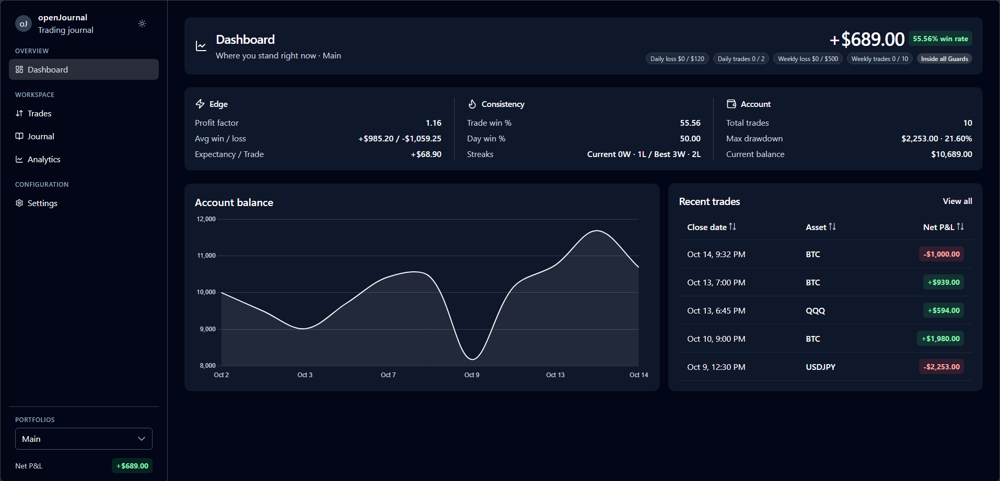

# openJournal

**A local-first trading journal that proves your edge.**

Log a closed Trade once. Every number — Net P&L, R-Multiple, win rate, drawdown — is derived from that one record, and your data never leaves your device.



## What it does

openJournal is a desktop-first journal for discretionary traders across stocks, futures, options, crypto, and forex. It answers one question — *where does Net P&L actually come from?* — by slicing performance by Setup, Asset, Side, time, and process signals instead of stopping at a P&L number.

- **Local-first** — Trades, Portfolios, and settings live in your browser's localStorage. No account, no server, no broker sync.
- **One source of truth** — Net P&L (Gross P&L minus Fees) drives every metric; filtered views never fork the math.
- **Process separate from outcome** — Compliance, Mistake, and Grade measure execution independently of profit.

## Features

### Dashboard

- Headline Net P&L and win rate, with Edge / Consistency / Account KPI band
- Balance curve anchored at the Portfolio's starting balance
- Five most recent Trades, newest close first, with a link to the full history
- Read-only Guard status when the active Portfolio has a Guard configured

### Trades

- Full history table: close date, Asset, Side, Net P&L, R-Multiple, Setup, Grade, Compliance, Tags
- Log form split into Trade & execution and Process, including a Playbook rule checklist
- Global filter bar: close-date range, Asset, Setup, Side, Tag, Win/Loss/Breakeven, Grade, needs review
- CSV export, sortable columns, and row expansion for notes, Emotions, and the Playbook snapshot
- An Undo toast after each save removes the Trade and restores the draft

### Journal

- Month calendar bucketed by UTC close date, with local date display
- Selected-day detail table and one Month report card covering outcome and process metrics
- Copy the month summary to the clipboard

### Analytics

- R-Multiple metrics: R-Expectancy, median R, risked total, risked coverage
- Breakdowns by Setup, Asset, Market, Side, Emotion-before/after, Mistake, Grade, and Tag
- Top 10 by |Net| chart above a table that keeps every row
- Time patterns by weekday, hour, and Hold Duration
- Compliance-versus-outcome buckets

### Settings

- Portfolios with names and starting balances
- Guards — optional daily or weekly brakes on loss, Trade count, or stop time; warn-only, never blocking
- Vocabulary for Setup, Emotion, and Mistake values
- Playbooks with optional Rules

### Portfolios

- Each Portfolio is its own performance unit with a USD starting balance (default $10,000)
- All aggregates every Portfolio as a read-only view
- The active Portfolio scopes Dashboard, Trades, Journal, Analytics, and Guards

## Tech stack

| Area | Choice |
| --- | --- |
| Framework | Angular 22 — standalone components, signals, lazy routes |
| UI | PrimeNG 21 on an Aura-based NoirSlate preset, Tailwind CSS 4 |
| Charts | Chart.js |
| Data | SignalDB persisted to localStorage |
| Tests | Vitest + jsdom |
| Tooling | Angular CLI, TypeScript 6, Prettier |

## Getting started

### Prerequisites

- Node.js 22.22.3+, 24.15+, or 26+ (Node 24 LTS recommended)
- npm 11+

### Run locally

```bash
npm install
npm start
```

Open [http://localhost:4200](http://localhost:4200). The app reloads when source files change.

### Seed demo data

```bash
node scripts/seed-dev.mjs
```

The script prints a ready-to-run `localStorage.setItem(...)` line with ten deterministic demo Trades. Paste it into the browser console and reload. Pass `--json` to print the raw array instead.

### Production build

```bash
npm run build
```

Build artifacts are written to `dist/`.

## Scripts

All commands run from this directory.

| Command | What it does |
| --- | --- |
| `npm start` | Dev server at http://localhost:4200 |
| `npm run build` | Production build |
| `npm run check` | Typecheck app and specs, then run the unit suite |
| `npx tsc --noEmit` | Typecheck only |
| `npx vitest run --silent` | Run the full unit suite |
| `npx vitest run src/app/features/trades/trade-math.spec.ts` | Run a single spec |
| `node scripts/seed-dev.mjs` | Print a demo-Trade seed for localStorage |

## Project structure

```text
openJournal/
├── src/
│   ├── app/
│   │   ├── features/       # dashboard, trades, journal, analytics, settings
│   │   ├── ui/             # shared page hero, filter bar, empty state
│   │   ├── app.config.ts   # providers and PrimeNG preset
│   │   └── app.routes.ts   # five lazy-loaded routes
│   ├── styles.css          # Tailwind and design tokens
│   └── main.ts
├── scripts/seed-dev.mjs    # deterministic dev data
├── assets/readme/          # README screenshots
├── public/
├── PRODUCT.md              # product definition and route goals
├── DESIGN.md               # design token contract
└── .facts                  # atomic behavioral spec
```

## Data and privacy

Everything is stored in your browser under these localStorage keys:

- `signaldb-collection-openjournal-trades` — Trades
- `openjournal-portfolios` — Portfolio records and starting balances
- `openjournal-active-portfolio` — active Portfolio or the All aggregate
- `openjournal-taxonomy` — Setups, Emotions, Mistakes, Tags, and Playbooks
- `openjournal-guards` — Guard configuration per Portfolio
- `openjournal-theme-dark` — dark mode preference

Dates are stored as UTC ISO strings and displayed in local time; the Journal calendar and time buckets key off the UTC close date. Clearing site data erases the journal, so export your Trades to CSV first.

## Documentation

- [PRODUCT.md](PRODUCT.md) — product purpose, route goals, and constraints
- [DESIGN.md](DESIGN.md) — design token contract enforced by the test suite
- [.facts](.facts) — atomic behavioral spec for derivations and views
